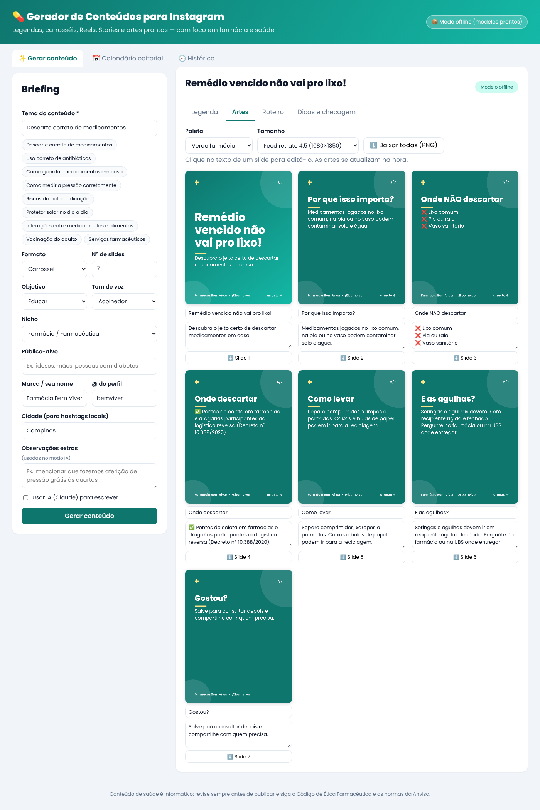

# 💊 Gerador de Conteúdos para Instagram

Ferramenta web para criar conteúdo de Instagram com foco em **farmácia e saúde**: legenda, hashtags, carrossel com artes prontas em PNG, roteiro de Reels, sequência de Stories e calendário editorial.



## O que ele faz

- **Legenda completa**: gancho, desenvolvimento, chamada para ação e aviso de saúde, com contador de caracteres (limite de 2.200) e de hashtags (limite de 30).
- **Hashtags** amplas, de nicho e locais (a partir da sua cidade).
- **Artes prontas** em 1080×1350, 1080×1080 ou 1080×1920, com 6 paletas, numeração dos slides e sua marca/@. Dá para editar o texto de cada slide, ver a arte mudar na hora e baixar em PNG.
- **Roteiro de Reels** cena a cena e **sequência de Stories** com enquete, quiz e caixa de perguntas.
- **Checagem ética**: sinaliza termos de risco em conteúdo de saúde ("cura", "milagroso", "100%", "sem efeitos colaterais", doses etc.), seguindo o espírito da RDC 96/2008 da Anvisa e do Código de Ética Farmacêutica.
- **Calendário editorial** de 7, 14 ou 30 dias, alternando formatos e objetivos, com exportação para CSV (abre no Excel). Clique em um dia para gerar o conteúdo dele.
- **Histórico** salvo no navegador; seus dados de perfil (marca, @, cidade) são lembrados.

### 9 temas prontos com conteúdo revisado

Descarte de medicamentos · Uso correto de antibióticos · Como guardar medicamentos · Como medir a pressão · Riscos da automedicação · Protetor solar · Interações medicamento-alimento · Vacinação do adulto · Serviços farmacêuticos.

Para outros temas, o modo offline monta uma estrutura-guia para você completar. Com o modo IA, o texto sai inteiro.

## Dois modos

| Modo | Precisa de quê | Resultado |
|---|---|---|
| **Offline** | Nada | Modelos prontos para os temas da lista e estrutura-guia para os demais |
| **IA (Claude)** | Chave da API da Anthropic | Texto original para qualquer tema, com as mesmas regras éticas |

## Como usar

### Online (Vercel)

O gerador está publicado na Vercel, no time **MGM** (projeto `gerador-conteudo-instagram`). É só abrir o endereço no navegador, no computador ou no celular.

Para ativar o modo IA na versão online:

1. No painel da Vercel, abra o projeto `gerador-conteudo-instagram` → **Settings → Environment Variables**.
2. Crie a variável `ANTHROPIC_API_KEY` com a sua chave da API da Anthropic.
3. Em **Deployments**, clique nos três pontos do último deploy → **Redeploy**.

A chave fica só no servidor da Vercel e nunca vai para o navegador.

### No seu computador

Precisa do [Node.js](https://nodejs.org) 18 ou mais recente.

```bash
npm install
npm start
```

Abra http://localhost:3000. Para ativar o modo IA, defina a chave antes de iniciar:

```bash
export ANTHROPIC_API_KEY="sua-chave"
npm start
```

Opcional: `PORT` muda a porta e `CLAUDE_MODEL` muda o modelo (padrão `claude-opus-5-5`).

## Testes

```bash
npm test
```

## Estrutura

```
server.js           servidor local (npm start)
api/                funções da Vercel (/api/status e /api/gerar)
lib/claude.js       lógica do modo IA, usada pelo servidor local e pela Vercel
vercel.json         configuração da publicação na Vercel
public/
  index.html        interface
  app.js            lógica da interface
  gerador.js        gerador offline, temas prontos, checagem ética, calendário
  arte.js           desenho das artes no canvas
  prompt.js         esquema JSON e prompts do modo IA
test/               testes automatizados
```

## Aviso

O conteúdo gerado é informativo e **deve ser revisado por profissional habilitado** antes de publicar. A checagem ética automática é um apoio e não substitui a leitura das normas do CFF e da Anvisa.
